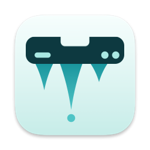
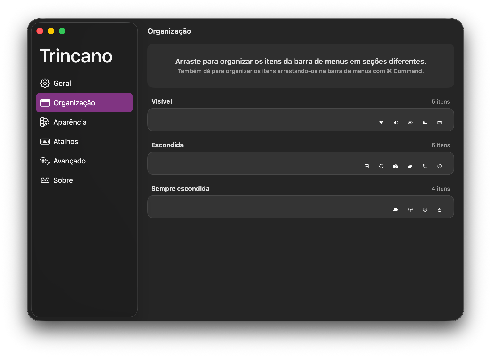
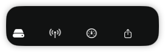
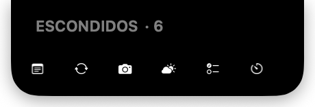
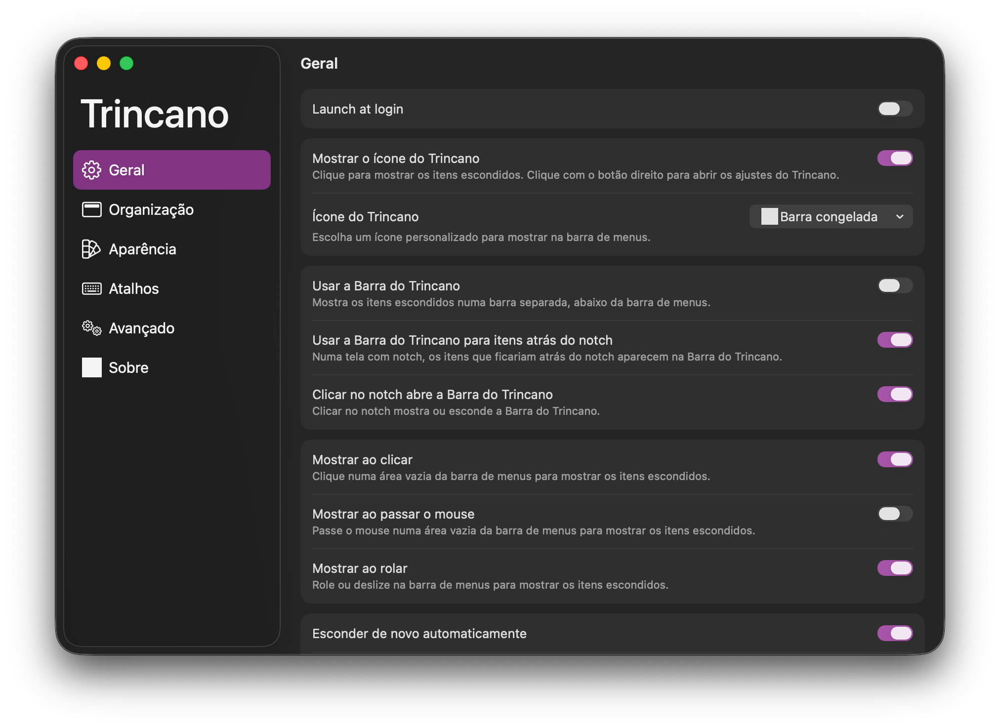
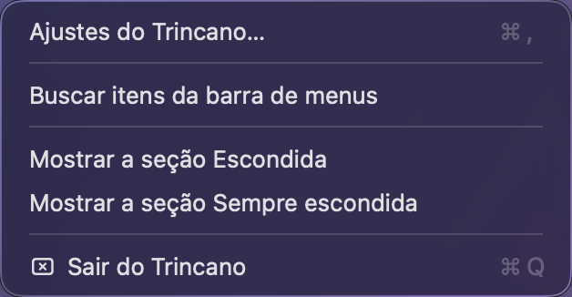

<div align="center">
    
    <h1>Trincano</h1>
    <p><strong>A menu bar manager for macOS, built for Macs with a notch.</strong></p>

[](https://github.com/PiluTech/trincano/releases/latest)


[](LICENSE)

[Download](https://github.com/PiluTech/trincano/releases/latest) · [Website](https://pilutech.com.br/apps/trincano) · [Report a bug](https://github.com/PiluTech/trincano/issues/new/choose)

</div>

Trincano hides and shows the items in your menu bar. When there is no room left (for example, when items end up behind the notch), it shows them in the **Trincano Bar**, a bar that appears right below the menu bar.



> [!IMPORTANT]
> **Trincano is a modified version of [Ice](https://github.com/jordanbaird/Ice), by Jordan Baird.** It is free software released under the [GNU General Public License v3.0](LICENSE), like Ice. It is based on Ice's `macos-26` branch. Modified by Paulo Victor T Silva (PILUTECH), 2026. Many thanks to Jordan Baird and to everyone who contributed to Ice. This project is not affiliated with or endorsed by the Ice project.

## Features

### What Trincano adds to Ice

- **Notch aware.** On a Mac with a notch, items that would end up hidden behind it appear in the Trincano Bar instead. The bar opens automatically when the hidden items do not fit to the right of the notch, and you can click the notch to open it. Both options are on by default and can be turned off in Settings > General.
- **Better on macOS 26 (Tahoe).** Fixes and fallbacks for the issues Ice has on Tahoe, including a ScreenCaptureKit fallback.
- **Multiple displays.** Each display can use the Trincano Bar or expand the menu bar inline. The choice is remembered per display, so it comes back by itself when you reconnect a monitor. Opening, hiding and timed rehide follow the display that has the active menu bar. The per-display setting appears in Settings > General when two or more displays are connected.
- **Fast and light.** On the author's MacBook Air M4 (macOS 26.6.2) the app sat at about 0% CPU and 56 MB of memory when idle, and the Trincano Bar took a median of 34 ms to show. See [docs/estado-atual.md](docs/estado-atual.md) for the numbers.
- **English and Brazilian Portuguese.** The interface follows the system language.
- **Accessibility.** Animations take 150 to 300 ms and turn off with "Reduce motion". Menu bar controls, the Trincano Bar and the search have VoiceOver labels. VoiceOver actions to move items in the layout editor are not available yet.
- **Easy updates, only with your consent.** A standard window shows the release notes (in Portuguese) with Install, Remind Me Later and Skip This Version. Automatic daily checks stay off until you agree (it asks on the second launch); there is also "Check for Updates…" in the menu. Updates are signed with EdDSA. No telemetry.
- **Drag-and-drop install.** The `.dmg` has a ready window, and if Trincano opens outside the Applications folder it offers to move itself there.
- **Swift 6** with strict concurrency checking and no warnings.

### Inherited from Ice

- Hide menu bar items, with an "always hidden" section
- Show hidden items by hovering over the menu bar, clicking an empty area, or scrolling or swiping in the menu bar
- Automatically rehide items
- Hide application menus when they overlap with the items being shown
- Drag-and-drop interface to arrange items
- Search menu bar items
- Menu bar item spacing (beta)
- Menu bar appearance: tint (solid and gradient), shadow, border and custom shapes (rounded and/or split)
- Hotkeys to toggle menu bar sections, show the search panel, enable or disable the Trincano Bar, show or hide the section divider icons and toggle application menus
- Launch at login

## Screenshots

All screenshots use a fixture with fictional menu bar items.

| The Trincano Bar | The Trincano Bar, anchored to the notch |
| :---: | :---: |
|  |  |

| General settings | The Trincano menu |
| :---: | :---: |
|  |  |

The screenshots are in Brazilian Portuguese. See [docs/prints/README.md](docs/prints/README.md) for how they are generated.

## Install

### Homebrew

```sh
brew trust pilutech/tap
brew install --cask pilutech/tap/trincano
```

The cask comes from the [PiluTech/homebrew-tap](https://github.com/PiluTech/homebrew-tap) tap. Current versions of Homebrew require you to trust a third-party tap before installing from it, which is what `brew trust` does.

### Download

Download `Trincano-<version>.dmg` from the [latest release](https://github.com/PiluTech/trincano/releases/latest), open it and drag **Trincano** to the Applications folder. Each release is signed with a Developer ID and notarized by Apple, and names the tag and the commit of its source code (GPL).

Do not run Trincano and Ice at the same time: both manage the same menu bar.

## Requirements and permissions

- macOS 14 (Sonoma) or later.
- **Accessibility** and **Screen Recording**, granted in System Settings > Privacy & Security. Trincano uses them only to read the position and image of menu bar items.

The signature of a release differs from the signature of a build made with a local certificate, so **macOS asks for Accessibility and Screen Recording again** the first time you open a release. It also asks again when you install over a previous version.

If you used Ice before, Trincano offers once, on first launch, to import your Ice settings (read-only, known keys only, never overwriting anything).

## Build from source

Requires Xcode 26 and macOS 26. The scripts are in [`scripts/`](scripts):

```sh
scripts/build.sh      # Release build, signed with a local certificate
scripts/install.sh    # copies to /Applications/Trincano.app (never closes Ice)
scripts/check.sh      # swiftlint + tests + build (everything runs locally)
```

The build is signed with a self-signed local certificate ("Trincano Local Signing", created on first build in `~/.trincano/signing`) so macOS remembers the permissions between builds. To sign with another identity (for example, a Developer ID), set `SIGN_IDENTITY`. See [docs/assinatura.md](docs/assinatura.md).

To run the tests only:

```sh
xcodebuild -project Ice.xcodeproj -scheme TrincanoTests -destination 'platform=macOS' test
```

## Architecture

| Folder | What it holds |
| --- | --- |
| `Ice/` | The app (the Swift module and Xcode target are still called `Ice`, to keep cherry-picks from upstream clean) |
| `MenuBarItemService/` | XPC helper embedded in the app. The channel between them checks the peer's code signature (`XPCPeerPolicy`) |
| `Shared/` | Code shared by the app and the helper |
| `Tests/TrincanoTests/` | Unit tests (Swift Testing) |
| `scripts/` | Build, install, release, checks and measurement scripts |
| `docs/` | Project documentation, in Portuguese |

Decision logic (notch geometry, Trincano Bar policies, rehide, display resolvers) lives in small pure types under `Ice/Utilities/Pure/` and `Shared/Utilities/`, compiled straight into the test target. Release builds are made with `scripts/release.sh`, which signs, notarizes and staples the app and the `.dmg` ([docs/assinatura.md](docs/assinatura.md)).

## Privacy

Everything stays on your Mac. Trincano has no telemetry and no analytics. It only reaches the internet to look for updates (one HTTPS request a day to `github.com/PiluTech/trincano`), and **only after you allow it**; until then the app makes no network requests. Details in [docs/atualizacao.md](docs/atualizacao.md). The Accessibility and Screen Recording permissions are used only to read the position and image of menu bar items.

## Documentation

See [docs/](docs/) (in Portuguese), starting with [docs/estado-atual.md](docs/estado-atual.md). [FREQUENT_ISSUES.md](FREQUENT_ISSUES.md) is inherited from Ice and mentions Ice by name.

## Contributing

Issues are welcome. Pull requests go against `main` of this repository, never against Ice. Before opening one, run `scripts/check.sh`. For bug fixes, add a test that fails first. New user-facing text goes in the String Catalog (`Ice/Resources/Localizable.xcstrings`, English and Brazilian Portuguese). See [CODE_OF_CONDUCT.md](CODE_OF_CONDUCT.md).

## License and credits

Trincano is available under the [GPL-3.0 license](LICENSE), the same license as Ice. It is a modified version of [Ice](https://github.com/jordanbaird/Ice) by Jordan Baird, based on Ice's `macos-26` branch; the original copyright notices and headers are kept. Thanks to Jordan Baird and to everyone who contributed to Ice.

Trincano is not affiliated with or endorsed by the Ice project.
